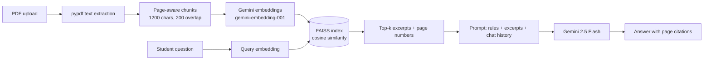

# 📄 Research Paper Q&A — LLM Mini Project (PS36)

**Sandesh** · Roll No. 36 · PRN ADT23SOCB0965 · B.Tech CSE, MIT ADT University, Pune

## Problem statement
Research papers are dense and long, and students lose hours hunting for one number or one idea in them. This app lets a student upload any research paper (PDF) and ask questions in plain English. It answers **only from the paper's text** and cites the **page number** for every claim, so each answer can be checked against the source.

## Features
- Upload any text-based research paper (PDF)
- Chat with follow-up questions ("explain that more simply")
- One-click questions: Summary, Contributions, Method, Results, Limitations
- Page citations `[p. N]` plus the exact excerpts used, with similarity scores
- Refuses to guess when the paper doesn't contain the answer
- Switch between the baseline (v1) and grounded (v2) prompts to compare them
- Embeddings cached on disk, so a paper is indexed only once
- Download the chat as Markdown

## How it works (RAG)

Chunks never cross page boundaries, so every excerpt maps to exactly one page and every citation is exact.

## Tech stack
| Part | Choice |
|---|---|
| Language | Python 3.10+ |
| LLM | Gemini 2.5 Flash via the Gemini API (`google-genai` SDK) |
| Embeddings | `gemini-embedding-001` (768-dim) |
| Vector store | FAISS (`IndexFlatIP` on normalised vectors) |
| PDF parsing | pypdf |
| UI | Streamlit |

## Run it
1. Get a free API key at <https://aistudio.google.com/apikey>.
2. Set up and start:
   ```bash
   python -m venv venv
   venv\Scripts\activate          # macOS/Linux: source venv/bin/activate
   pip install -r requirements.txt
   copy .env.example .env         # macOS/Linux: cp .env.example .env
   # paste your key into .env as GEMINI_API_KEY=...
   streamlit run app.py
   ```
   On Windows you can just double-click **`run.bat`**, which does all of the above.
3. Upload a paper from the sidebar and start asking.

## Prompt
System prompt (v2, the default):
```text
You are a research assistant helping a student understand ONE research paper.

Rules:
1. Answer ONLY from the excerpts inside <context>. Do not use outside knowledge about the paper, its authors, or later work.
2. After every factual claim, cite the page it came from, e.g. [p. 4]. Use only page numbers that appear in the excerpt headers.
3. If the excerpts do not contain the answer, reply: "The paper excerpts I retrieved don't cover this." and suggest a more specific question. Never guess.
4. Copy numbers, metrics, dataset names and equations exactly as written in the excerpts.
5. Be concise: one short paragraph or at most 6 bullet points. Explain jargon in plain words the first time it appears.
6. Use <conversation_so_far> only to resolve follow-ups like "explain that more simply"; facts must still come from <context>.
```
Each request then carries the paper title, the top-k excerpts labelled `[Excerpt n | p. N]`, the last few chat turns and the question.
The v1 baseline (`Answer the question about the research paper using the excerpts below.`) is still selectable in the sidebar for comparison.

## Test inputs
Test plan using *Attention Is All You Need* (arXiv:1706.03762, PDF from arxiv.org):

| # | Input | What a correct answer looks like |
|---|---|---|
| 1 | 📝 Summary button | Problem, Transformer architecture, results, takeaway, with citations |
| 2 | What is multi-head attention and why use several heads? | Explanation grounded in the attention section |
| 3 | What BLEU score did the big model get on WMT 2014 English-to-German? | 28.4, cited to the results table page |
| 4 | Why do they use sinusoidal positional encodings? | The authors' stated reason (extrapolating to longer sequences) |
| 5 | What does this paper say about GPT-4? | Refusal: the paper doesn't cover it |
| 6 | Explain that more simply. *(follow-up)* | Simpler restatement of the previous answer |

## Screenshots
<!-- add 1–2 images from the screenshots/ folder, e.g.  -->

## Project structure
```
├── app.py            Streamlit UI
├── rag.py            PDF parsing, chunking, embeddings, FAISS search, prompts
├── requirements.txt
├── run.bat           Windows one-click setup + run
├── .env.example      template for your API key (.env itself is git-ignored)
└── screenshots/
```

## Limitations and future work
- Scanned (image-only) PDFs have no extractable text, so they need OCR first.
- Tables and equations come out of PDF extraction as flat text, so answers about complex tables can be imperfect.
- One paper at a time. Next step: multi-paper comparison ("how does paper A's method differ from paper B's?").
